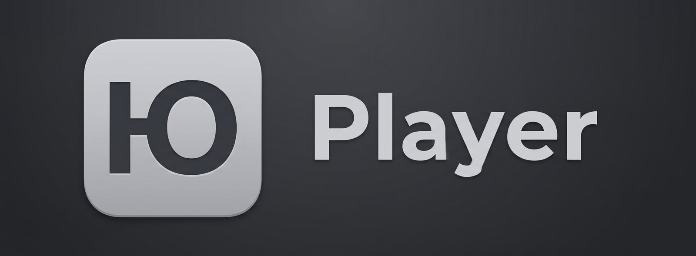

<p align="center">
  
</p>

<h1 align="center">UPlayer</h1>

<p align="center">
  Передачи телеканала «Ю» на Android TV: каталог и нормальный плеер вместо браузера.
</p>

<p align="center">
  <a href="https://github.com/sharl0t/UPlayer/releases/latest"></a>
  <a href="https://irlme.online"></a>
  
  
  
</p>

> Неофициальное приложение. Автор не связан с телеканалом «Ю» и сайтом u-tv.ru. Видео и картинки берутся
> с открытого сайта u-tv.ru, все права на них принадлежат правообладателям.

## Что умеет

- **Каталог передач** с сайта u-tv.ru: сезоны, серии, длительность, картинки.
- **Плеер ExoPlayer** с адаптивным качеством (до 1080p) и ручным выбором: Авто, 1080p, 720p, 468p, 360p, 240p.
- **Пульт**: всё управляется крестовиной, OK и «Назад», фокус всегда виден.
- **Лёгкий**: APK 1,5 МБ, без Google Play Services. Проверен на слабой приставке Rombica Go (Android 10, 2 ГБ).
- Не хранит историю, избранное и аккаунты. Раз в сутки отправляет обезличенную статистику устройства, её можно выключить в настройках; подробности в разделе «Какие данные отправляются».

Чего нет: эфира, поиска, «продолжить с места» и избранного. Анонсы (минутные трейлеры) не показываются.

## Установка

**Нужно:** приставка или телевизор на Android TV 6.0 и новее, интернет.
Подходит любой процессор (ARM, ARM64, x86).

Скачайте `UPlayer.apk` со страницы [Releases](https://github.com/sharl0t/UPlayer/releases/latest)
и установите одним из способов.

### Способ 1. Прямо на приставке, через Downloader

1. Установите из Google Play приложение **Downloader** (AFTVnews).
2. Разрешите Downloader ставить приложения: в настройках найдите «Неизвестные источники» (обычно Настройки
   устройства → Безопасность и ограничения) и включите их для Downloader. На Android TV 6 и 7 там один
   общий переключатель.
3. В Downloader введите адрес:
   ```
   https://github.com/sharl0t/UPlayer/releases/latest/download/UPlayer.apk
   ```
4. Нажмите «Установить». Приложение появится в ряду приложений на главном экране.

### Способ 2. С флешки

1. Скопируйте `UPlayer.apk` на флешку и вставьте её в приставку.
2. Откройте файл любым файловым менеджером (например, X-plore или «Файлы»), разрешите установку
   из неизвестных источников, если система спросит.

### Способ 3. Через adb с компьютера

Включите на приставке отладку по сети (Настройки → Для разработчиков), затем:

```
adb connect <IP приставки>
adb install -r UPlayer.apk
```

После установки отладку по сети лучше выключить.

### Обновление

Новая версия ставится поверх старой тем же способом.

## Какие данные отправляются

Пока включён переключатель «Делиться обезличенными данными» (в настройках, по умолчанию включён), раз в сутки,
при запуске, приложение отправляет на сервер автора (`irlme.online`) один короткий запрос.
Он нужен, чтобы понимать, на каких приставках и версиях Android приложение реально работает.

Отправляется:

- случайный идентификатор установки (UUID), он создаётся при первом запуске и никак не связан с вами,
  вашим аккаунтом или устройством; при переустановке приложения создаётся новый;
- производитель и модель устройства;
- версия Android (API);
- архитектура процессора;
- версия UPlayer.

Не отправляется: что вы смотрите, история, имя, почта, аккаунты, список установленных приложений, серийные номера
и рекламные идентификаторы.

Сервер, как любой сервер, видит IP-адрес запроса и записывает его в журнал вместе с этими данными. Адрес
используется только для защиты от мусорных запросов и в статистику не попадает. Если нет сети, запрос тихо
пропускается и на работу приложения не влияет. Отправку можно выключить в настройках (кнопка на главном экране):
после этого запросов больше нет. Можно и закрыть доступ к `irlme.online` в роутере: всё остальное продолжит работать.

## Управление

| Кнопка | Что делает |
|---|---|
| Крестовина, OK | выбор передачи, сезона, серии |
| OK в плеере | пауза и продолжение, показать панель |
| ⏪ и ⏩ на панели | назад на 10 с, вперёд на 30 с |
| Влево и вправо на полосе прокрутки | перемотка шагом 1 % |
| «Качество» на панели | Авто или конкретная высота кадра |
| «Назад» | спрятать панель, затем выйти к списку серий |

В конце серии плеер закрывается сам.

## Если что-то не работает

- **«Приложение не установлено»** при обновлении: удалите старую версию и поставьте заново. Удалять не страшно,
  приложение ничего не хранит.
- **Ошибка загрузки каталога**: проверьте интернет и нажмите «Повторить». Если не помогло, возможно, сайт u-tv.ru
  поменял разметку. Напишите в [Issues](https://github.com/sharl0t/UPlayer/issues): модель приставки,
  версия Android, что именно на экране.
- **Видео не идёт**: попробуйте выбрать качество пониже кнопкой «Качество».

---

## Для разработчиков

### Стек

Kotlin, Leanback (без Compose: приставки слабые), Media3 ExoPlayer с HLS через OkHttp, OkHttp + jsoup для разбора
сайта, Coil для картинок. Без нативного кода и Google Play Services. minSdk 23, пакет `ru.sharl0t.utvplayer`.
Карта файлов: [docs/MAP.md](docs/MAP.md), ход работы: [TASKS.md](TASKS.md).

### Сборка

Нужны JDK 17 и Android SDK (compileSdk 34).

```
./gradlew assembleDebug      # app/build/outputs/apk/debug/app-debug.apk
./gradlew assembleRelease    # app/build/outputs/apk/release/app-release.apk (R8, 1,5 МБ)
UTV_LIVE=1 ./gradlew testDebugUnitTest   # разбор живого сайта (LiveSiteTest), вывод в app/build/test-results
```

Релиз подписывается ключом из `keystore.properties` в корне проекта (поля `storeFile`, `storePassword`, `keyAlias`,
`keyPassword`). Файла нет в репозитории; без него релиз подписывается отладочным ключом и тоже ставится,
но не поверх официальных сборок из Releases.

Отладочная сборка весит 7,5 МБ и по Wi-Fi ставится плохо. Проще через флешку, из `adb shell`:
`cat /storage/<флешка>/app-debug.apk | pm install -S <размер в байтах>`.

### Решения

- Экраны: только каталог: передачи → сезоны → серии → плеер. Без «новых серий», эфира и поиска.
- Памяти нет: ни «продолжить с места», ни отметок, ни избранного. Единственное, что приложение хранит
  (SharedPreferences): случайный UUID установки, время последнего пинга и флаг «Делиться обезличенными данными».
- Статистика устройств (решение 2026-11-02): раз в сутки при запуске фоновый запрос
  `GET https://irlme.online/ping?id=<uuid>&m=<производитель>&d=<модель>&a=<API>&abi=<архитектура>&v=<версия>`,
  ответ 204. Без блокировки запуска, при ошибке сети тихо. Больше ничего не отправлять без отдельного решения
  и обновления раздела «Какие данные отправляются». Пользователь может выключить отправку в настройках
  (решение 2026-11-02, по умолчанию включено; при выключении `Stats` ничего не шлёт). Сервер пишет в `log/ping.log` (в том числе IP),
  сводка: `tools/ping-stats.py`.
- Настройки (решение 2026-11-02): отдельный экран с входом с главного экрана. Два блока: переключатель статистики
  (под ним только для показа сведения об устройстве: производитель, модель, Android, архитектура, версия UPlayer; на случай,
  если статистику выключили, а что-то сломалось) и ссылки (сайт irlme.online, Telegram @IRLME) с QR-кодами. Других настроек нет.
- Качество: авто (адаптивный HLS), с ручным выбором в плеере.
- Реклама: не показывать, брать только сам видеопоток.
- Устройства: любые Android TV от Android 6 (minSdk 23), управление пультом. Главная проверка на Rombica Go
  (Android 10, 32-битный ARM, 2 ГБ, слабый процессор H313).
- Анонсы (псевдосезон «анонс» с минутными трейлерами) не показывать.
- Передачи без серий (например, «Дом-2», у него на сайте только анонсы) показывать в каталоге,
  внутри надпись «серий нет».

### Как сайт отдаёт видео (проверено 2026-11-02)

1. Страница серии, например `https://www.u-tv.ru/shows/mama-v-16/episodes/1901071/`, содержит атрибут
   `data-edge-player="https://media.u-tv.ru/videos/<id>?player_id=…&ad_id=…"`.
2. Страница `https://media.u-tv.ru/videos/<id>` содержит название в `og:title` и ссылку
   `https://cdn.media1.ru/videos/<id>/master.m3u8`.
3. `master.m3u8` открывается без ключей, cookie и Referer: 240p–1080p, H.264 + AAC, 25 кадров/с.
4. Адрес потока можно собрать и без шага 2: `https://cdn.media1.ru/videos/<id>/master.m3u8`, где `<id>` берётся
   из `data-edge-player`. Приложение сначала читает страницу media, а этот адрес использует как запасной.

### Каталог на сайте (проверено 2026-11-02)

- `/shows/`: в HTML первые 30 передач (`a.projects__item`, название в `.projects__name`, картинка в
  `picture source[srcset]`). Остальные отдаёт `POST /projects/loading/` с полями `tab=all&page=N&sort=new&slug=shows`,
  заголовками `X-CSRF-TOKEN` (из `<meta name="csrf-token">`) и `X-Requested-With: XMLHttpRequest` и cookie
  со страницы `/shows/`. Ответ: JSON `{html, btnNextLoad, btnNumberPage, countProjectsToFilter}`. На 2026-11-02 всего
  78 передач, 1240 серий; у 31 передачи (старые: «Званый ужин», «Маша и Медведь» и т. п.) на сайте только описание,
  серий нет.
- `/shows/<slug>/`: сезоны лежат в HTML целиком, блоками `div.defaultTabs__item[data-season="1 сезон"][data-total=N]`.
  Серия: `a.swiperGroup__slide` (ссылка абсолютная), `.swiperGroup__name` («1 сезон 3 серия»), `img[alt]`
  («Мама в 16. 3 серия. Анна, Ростов-на-Дону»), `.timeVideo` («73 мин»). Проверено на трёх передачах:
  `data-total` совпадает с числом серий в HTML. Названия сезонов бывают не только «N сезон»: «эксклюзив сезон»,
  «Интервью сезон».

### Сертификаты

`www.u-tv.ru` подписан GlobalSign Root R46, `media.u-tv.ru` и `cdn.media1.ru` выстроены до ISRG Root X2,
`img.u-tv.ru` до GlobalSign Root R3. R46 и X2 нет в старых Android (в том числе, вероятно, на Android 10),
поэтому корни лежат в `res/raw/extra_roots.pem` и добавляются к системным в OkHttp (`data/Net.kt`).
Через этот же клиент идут картинки (Coil) и видео (media3-datasource-okhttp).

---

## История изменений

### 0.3 (2026-11-02)

- Настройки (шестерёнка в заголовке каталога): переключатель «Делиться обезличенными данными», сведения об устройстве, QR-коды сайта irlme.online и Telegram @IRLME.
- Раз в сутки обезличенная статистика устройства, по умолчанию включена, выключается в настройках.

### 0.1 (2026-11-01)

- Первая версия: каталог передач, сезоны и серии, плеер ExoPlayer с адаптивным качеством и ручным выбором, управление пультом.
